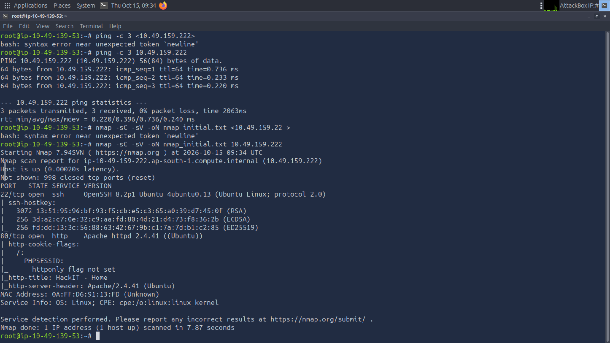
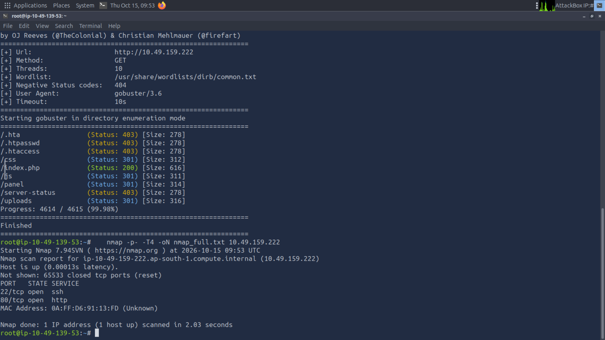
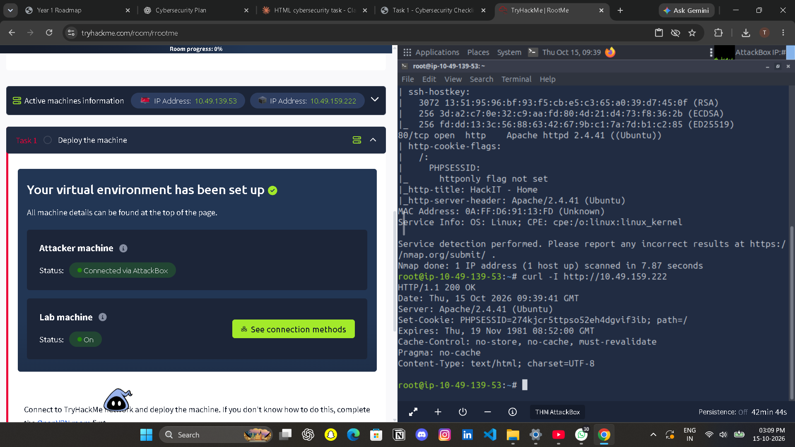
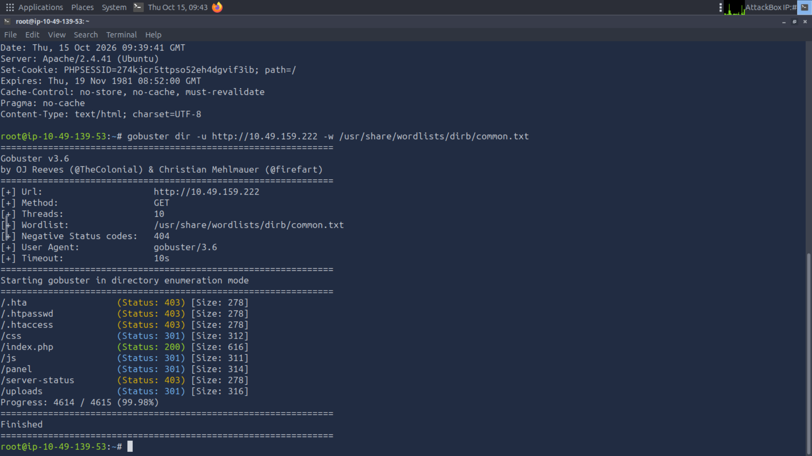
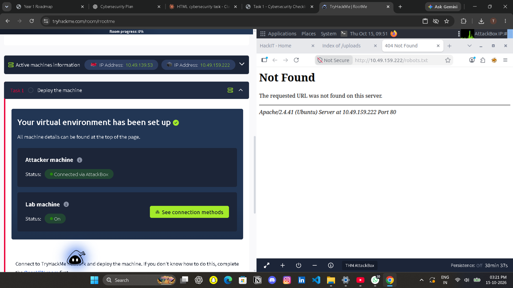

# Task 1 - Cybersecurity: Basic Web Recon

**Name:** Tushant
**Target:** TryHackMe room "RootMe" (intentionally vulnerable training machine)
**Target IP:** 10.49.159.222 (changes every time the room is started)
**Attacker machine:** TryHackMe AttackBox (10.49.139.53)

> Only the machine deployed by TryHackMe for this room was scanned. No exploitation was attempted; this report only covers reconnaissance and observations.

## Folder structure

```
Tushant/
├── README.md
├── nmap/
│   └── recon_output.txt
└── screenshots/
    ├── nmap_initial.png
    ├── nmap_full.png
    ├── headers.png
    ├── gobuster.png
    ├── panel.png
    ├── uploads.png
    └── robots.png
```

The terminal output of every command is captured in the screenshots folder. A text copy of the output, transcribed from those screenshots, is in `nmap/recon_output.txt`.

## Commands used

| Purpose | Command |
|---|---|
| Check the target is reachable | `ping -c 3 10.49.159.222` |
| Scan common ports, run default scripts, detect versions | `nmap -sC -sV -oN nmap_initial.txt 10.49.159.222` |
| Scan all 65,535 ports | `nmap -p- -T4 -oN nmap_full.txt 10.49.159.222` |
| View HTTP response headers | `curl -I http://10.49.159.222` |
| Find hidden directories | `gobuster dir -u http://10.49.159.222 -w /usr/share/wordlists/dirb/common.txt` |
| Manual checks in Firefox | `/robots.txt`, `/panel/`, `/uploads/` |

## Nmap results

Both the default scan and the full-port scan found only two open ports.

| Port | State | Service | Version |
|---|---|---|---|
| 22/tcp | open | SSH | OpenSSH 8.2p1 Ubuntu |
| 80/tcp | open | HTTP | Apache httpd 2.4.41 (Ubuntu) |

The other 65,533 ports were closed. The website title is "HackIT - Home".




## Other recon findings

**HTTP response headers** (`curl -I`): the server returned `Server: Apache/2.4.41 (Ubuntu)` and a `Set-Cookie: PHPSESSID=...; path=/` header. No security headers were present.



**Directory scan** (gobuster): found `/css`, `/js`, `/index.php`, `/panel`, `/uploads`. The paths `/.htaccess`, `/.htpasswd`, `/.hta` and `/server-status` returned 403 (blocked).



**robots.txt:** the file does not exist (404 Not Found), so nothing is leaked through it.



## Security observations

### 1. Server and service versions are exposed
- **Evidence:** Nmap shows Apache 2.4.41 and OpenSSH 8.2p1; the `Server` header and the 404 page also show `Apache/2.4.41 (Ubuntu)`. (`nmap_initial.png`, `headers.png`)
- **Why it matters:** Attackers can look up known vulnerabilities for those exact versions and pick matching exploits.
- **Remediation:** Hide version information (`ServerTokens Prod` and `ServerSignature Off` in Apache) and keep the software updated.

### 2. Session cookie is missing security flags
- **Evidence:** The `PHPSESSID` cookie has no `HttpOnly` flag (Nmap), and the `curl -I` output shows no `Secure` or `SameSite` flag either. (`nmap_initial.png`, `headers.png`)
- **Why it matters:** Without HttpOnly, JavaScript can read the cookie, so a cross-site scripting bug could allow session theft. Without Secure, the cookie can be sent over unencrypted HTTP.
- **Remediation:** Set `session.cookie_httponly=1`, `session.cookie_secure=1` and `session.cookie_samesite=Lax` in `php.ini`.

### 3. Important security headers are missing
- **Evidence:** The response has no `X-Frame-Options`, `Content-Security-Policy`, `X-Content-Type-Options` or `Strict-Transport-Security`. (`headers.png`)
- **Why it matters:** The site could be loaded inside another page (clickjacking), and browsers have fewer protections against script injection and content sniffing.
- **Remediation:** Add the headers, for example `X-Frame-Options: DENY`, `X-Content-Type-Options: nosniff` and a Content-Security-Policy.

### 4. Public file upload page with no authentication
- **Evidence:** `/panel/` shows a "Select a file to upload" form with no login. It was found by gobuster. (`panel.png`, `gobuster.png`)
- **Why it matters:** Anyone who finds the page can upload files. If file types are not checked, an attacker could upload a script and run code on the server.
- **Remediation:** Require authentication, restrict access by IP, allow only safe file types (checking content, not only the extension), rename uploaded files and store them outside the web root.

### 5. Directory listing is enabled on /uploads/
- **Evidence:** `/uploads/` shows "Index of /uploads" with a file listing page. (`uploads.png`)
- **Why it matters:** Visitors can browse the folder's contents. Together with the public upload form, uploaded files would be easy to find and open.
- **Remediation:** Disable directory listing (`Options -Indexes`) and block script execution inside the uploads folder.

### 6. No HTTPS
- **Evidence:** Only port 80 (HTTP) is open; the browser shows "Not Secure". (`nmap_full.png`, `panel.png`)
- **Why it matters:** Cookies and any data sent to the site can be read or changed by someone on the network.
- **Remediation:** Install a TLS certificate, enable port 443 and redirect HTTP to HTTPS.

## What I learned

In this task I used Nmap to find open ports and services on a TryHackMe machine, then checked the website with curl, gobuster and Firefox. I learned that even a simple scan can reveal software versions, hidden folders and missing security settings. The most important finding was a public upload page at /panel with no login. I also learned that a task like this should only be done on machines I have permission to test. I did this task with guidance from an AI assistant (Claude), and I’m still building my understanding of how these issues are exploited and fixed.
